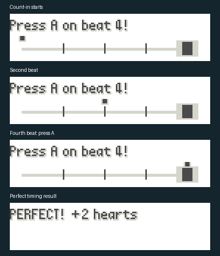

# Rhythm appeals

Solo contests keep their registration, conditions, categories, ranks, ribbons,
move selection, move animations and original contest effects. Immediately before
an eligible player move, a short timing challenge appears in the existing lower
left dialogue panel. The move-selection prompt also reminds you to press A
on the shown beat; the timing challenge starts later, during your Pokémon's appeal.

Each appeal randomly chooses **beat 2, 3 or 4**, never beat 1. Read the target
beat shown above the track, listen to the count-in clicks, then tap **A on that beat** as the marker
reaches the right-hand target. The cue has a fixed 30-frame beat interval (roughly
120 BPM). Contest music pauses for the cue and resumes afterward; these are
standalone rhythmic cues rather than charts tied to each background song.
The visual track remains usable without sound.

| Timing | Appeal bonus |
| --- | --- |
| Perfect | Four hearts (40 appeal points) |
| Good | Two hearts (20 appeal points) |
| Miss or no input | No bonus or additional penalty |

Only the first fresh A press counts. Holding A from move selection does not hit
the note; release it first. Early presses cannot be retried by mashing. Each cue
ends automatically, including when no button is pressed. Results display briefly
before the normal move animation and scoring continue.

| Contest rank | Perfect window | Good window |
| --- | --- | --- |
| Normal | ±4 frames | ±8 frames |
| Super | ±3 frames | ±7 frames |
| Hyper | ±2 frames | ±6 frames |
| Master | ±2 frames | ±5 frames |

NPC timing is simulated: Perfect/Good chances are 15%/40% at Normal, 25%/40% at
Super, 35%/45% at Hyper and 50%/40% at Master. The remainder are misses. NPCs use
the same two-heart maximum without waiting through an extra interactive cue.
Move effects, combo bonuses, repetition penalties and jamming retain their
existing calculations. Timing is added afterward without changing base appeal.
Nervous, resting, retired or move-less contestants receive no timing challenge or
bonus. Link contests retain their original scoring and packet layouts.

The contest callback advances this cue once per frame, independently of Brisk's
battle and overworld speed options. No new save fields are used. Instructions
are available under contest receptionist INFO → CONTESTS and Options → HELP →
CONTEST RHYTHM.

Implementation: `src/contest_rhythm.c`, integrated with the appeal state machine
in `src/contest.c`. Tests cover rank boundaries, held/multiple presses, timeout,
score preservation, NPC accuracy, link exclusions and the real appeal-to-animation
handoff with music restoration.

## Native panel preview

Captured from the GBA dialogue-window tile buffer at the start, second beat,
fourth beat and Perfect result. Pixels are enlarged 3×; transparency is shown
on white. This is the timing panel, not a full contest-screen screenshot.

