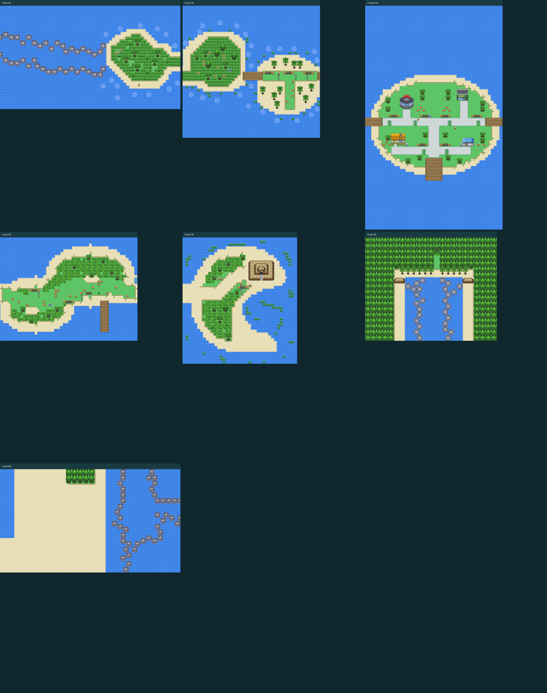

# Orange Islands

The Orange Islands and Valencia Island tilesets are used by Routes 143–146,
Orange City, and Routes 149–150. Routes 147–148 form the forest approach.

| Area | Dimensions | Features |
| --- | --- | --- |
| Route 143 | 63 × 36 | Rock-lined sea passage and grass island |
| Route 144 | 48 × 46 | Two islands linked by a boardwalk |
| Orange City | 48 × 78 | Center, Mega Stone mart, two homes, town square and harbor |
| Route 145 | 48 × 36 | Coastal trail and fishing pier |
| Route 146 | 40 × 44 | Crescent island, lookout and Dynamax Adventure cave |
| Route 147 | 29 × 16 | Forest approach from Route 141 |
| Route 148 | 29 × 16 | Forest clearing and teleporter to Route 149 |
| Route 149 | 46 × 36 | Return teleporter, beach paths and rocky sea passage |
| Route 150 | 63 × 36 | Sea passage linking Route 149 to Route 143 |

Orange City's paved streets and flower-lined rest areas connect both neighboring routes, the four building
entrances, town square and harbor. Each interior returns to its own front door.
The Center's healing, upper floor and respawn data are retained, with its outdoor
arrival position updated to the new doorway. The mart retains its custom Mega
Stone counter. Building walls and roofs are solid; front doors are usable.

The lookout scientist's cave on Route 146 has a walkable entrance and reciprocal
warp. Its outdoor resident stands beside the lookout rather than inside its roof.
The two Route 149 teleporter pads use their existing positions from the latest
map edit and connect back to Route 148. Grass quadrants are consistent and stray
grass fragments in open sea are removed. Encounter tables and story flags are
not regenerated by the map tool.

Run `python tools/brisk/orange_islands.py --check` to audit the current maps.
Use `--render` to update map previews, or `--polish --render` to apply the town
layout and grass cleanup explicitly. Checking/rendering reads the current map
files and does not overwrite their layouts. Preview dots mark NPC positions.

Tileset credits: [Orange Islands](../../resources/team_aqua/tilesets/orange_islands/README.md)
and [Valencia Island](../../resources/team_aqua/tilesets/valencia_island/README.md).

Benches fully restore the party's HP, PP and status, including fainted Pokemon,
using the same healing routine as a Pokemon Center. They do not change the
whiteout/Teleport destination. Mailboxes display a privacy reminder. Both
features use metatile behaviors, so the existing bench and mailbox tiles work
wherever they are placed with these tilesets. Lamps, flowers and rest areas
match the player's Route 144 design. Current dimensions, building entrances,
connection offsets and healing locations are retained by the cleanup tool.

Route 145 now has a flower-lined grass trail, palms, a third bench and a Hex
Maniac describing Lugia and the legendary birds' rescue of endangered species
about twenty years ago. The original island outline, fishing pier, connections
and encounter tables are retained.

`ISLAND SHINY` on Options page 5 defaults to ON: wild encounters on Routes
143–146, 149–150 and in Orange City use a base 1/50 shiny roll. OFF restores the
player's global shiny setting. Gifts, eggs, trainer teams, the forest approach,
indoor caves and Dynamax Adventures keep their existing odds. Existing Pokémon
are never recolored; ordinary shiny bonuses and explicit force-shiny rules remain.
