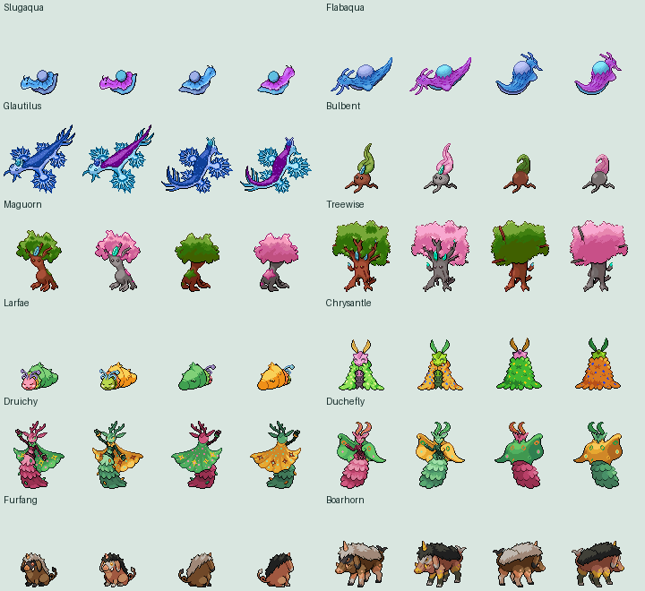

# Sacred Phoenix Fakémon

The twelve species in `cutecreature_sprite_1.7z` are implemented as independent
Hoenn species in `src/data/pokemon/species_info/gen_3_families.h`. Existing species
IDs, National Dex numbers and save offsets are retained. These additions are
not placed in encounter tables, gifts or trainer teams; placement remains yours.

| Evolution line | Types | Evolution |
| --- | --- | --- |
| Slugaqua → Flabaqua → Glautilus | Water → Water → Water/Dragon | Levels 20 and 40 |
| Bulbent → Maguorn → Treewise | Grass → Grass → Grass/Psychic | Levels 18 and 38 |
| Larfae → Chrysantle → Druichy / Duchefly | Bug/Fairy | Level 12, then level 36: male Druichy, female Duchefly |
| Furfang → Boarhorn | Ground/Dark | Level 34 |

All have authored stats, fitting abilities, level-up and teachable moves,
original Brisk Dex descriptions, supplied regular/shiny front and back sprites,
menu icons and supplied animated overworld graphics with separate shiny palettes.
The engine's 80×80 battle sprites are used; art exceeding that canvas is fitted
with nearest-neighbor scaling. The 64×64 menu previews use the same source art.
No artwork or shiny recoloring was generated. Sprite filenames determine spelling
(`Boarhorn`, versus `boarhom` in the supplied credit text).

To repeat asset conversion, extract the supplied archive, then run:

```
python tools/brisk/import_sacred_phoenix.py /path/to/CuteCreature_Sprite
```

Gameplay definitions are in `tools/brisk/sacred_phoenix_species.json`.
The import manifest records original filenames, source hashes and conversion sizes.

## Credits

All designs are from the **Sacred Phoenix team**. Original credits are preserved
verbatim in [the supplied credit file](../resources/sacred_phoenix/cutecreature_credit.txt).

- Slugaqua, Flabaqua, Glautilus: artwork by **FlorianDX and Amras Anárion**;
  fronts by **Amras Anárion**; backs, overworlds and icons by **Dracoyan**.
- Bulbent, Maguorn, Treewise: artwork by **eysselia**; pixel art by **MikuGoya**.
- Larfae, Chrysantle, Druichy, Duchefly: artwork by **Amras / anarlaurendil**;
  pixel art by **frillecho**.
- Boarhorn and Furfang: artwork by **splittygjaw and eysselia**;
  Furfang sprite credit **frillecho**. Both supplied filenames credit frillecho.


